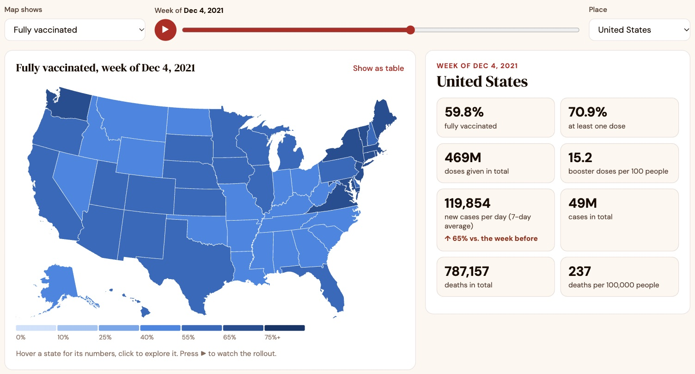

# COVID Vaccine Tracker

An interactive map of COVID-19 vaccinations, cases and deaths across all 50 US states and DC, from March 2020 to March 2023.

**Try it:** https://roopa-srinivas.github.io/COVIDVaccineTracker/dashboard/ · **About the project:** https://roopa-srinivas.github.io/COVIDVaccineTracker/



## Background
Built in 2021 by Roopa Srinivas, Sophie Lin and Nodoka Shibasaki as our high school AP Computer Science capstone: a Java desktop app (with Processing) that downloaded the latest data on launch. In 2026 I rebuilt it for the web, around the features our original design doc listed but we didn't have time to build: coloring states by percent vaccinated, browsing past weeks and months, hovering over states, and publishing it as a website.

## What the web version does
- **Map with a timeline:** color the US by percent fully vaccinated, at least one dose, boosters, new cases or deaths per 100,000 people, and scrub or play through 159 weeks
- **State detail:** numbers for the selected week, whether cases went up or down since the week before, and charts against the whole US
- **A forecast you can check:** a 3-week trend projected two weeks ahead, next to what actually happened and the trend's typical error
- **Doses by vaccine maker**, and the original app's May 2021 vaccine facts kept as a snapshot
- **Accessible:** keyboard-selectable states and a sortable table view of every map

## Data
The same sources the 2021 app used, both now archived:
- Cases and deaths: [The New York Times](https://github.com/nytimes/covid-19-data) (final update March 2023)
- Vaccinations by state and by maker: [Our World in Data](https://github.com/owid/covid-19-data), compiled from the CDC

`scripts/build_data.py` (Python, standard library only) turns the daily CSVs into a weekly snapshot at `dashboard/data/covid.json`. Where a state skipped reporting vaccinations for more than two weeks, it fills the gap with a straight line between the reports on either side and marks those weeks as estimated.

```sh
python3 scripts/build_data.py   # downloads the CSVs and rebuilds the snapshot
```

## Project structure
| Path | What it is |
|---|---|
| `dashboard/` | The web dashboard (D3, TopoJSON, plain JavaScript) |
| `dashboard/data/` | The weekly data snapshot and US state shapes from [us-atlas](https://github.com/topojson/us-atlas) |
| `scripts/build_data.py` | Builds the data snapshot |
| `index.html` | The project page |
| `CapstoneCOVIDVaccineTrackerProject/` | The original 2021 Java/Processing app, unchanged |

## The original team (2021)
- **Roopa Srinivas:** map and state pages (Country, State, MoreInfo), the state dropdown, the app frame, map images
- **Sophie Lin:** page transitions and buttons, the instructions page, graphics and layout, the presentation video
- **Nodoka Shibasaki:** data download and parsing, statistics and graphs, the case prediction, hovering, auto-updates

The web version (2026) is by Roopa Srinivas.
